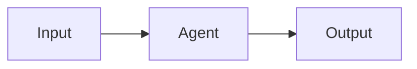

# Trace Blog 写作语法参考

本文档记录从 Mizuki 示例文章中保留下来的实用写作方式。它不会发布到博客。

## Frontmatter

```yaml
---
title: 文章标题
published: 2026-08-16
description: 一句话摘要
image: ""
tags:
  - Astro
  - 工程实践
category: 技术
draft: false
lang: zh_CN
---
```

常用可选字段：

- `updated`：最后更新时间。
- `pinned`：是否置顶。
- `priority`：多个置顶文章的顺序，数值越小越靠前。
- `comment`：单篇文章是否允许评论；全站评论仍受
  `src/config/commentConfig.ts` 控制。
- `alias`：文章 URL 别名。
- `permalink`：自定义固定链接，优先级高于 `alias`。
- `author`、`sourceLink`、`licenseName`、`licenseUrl`：转载或自定义署名。
- `encrypted`、`password`、`passwordHint`：密码保护内容。

日期使用 `YYYY-MM-DD` 或带时区的 ISO 8601 格式。文件名建议使用稳定的英文短横线
slug，例如 `agent-memory-design.md`。

## 图片

文章专属图片推荐与文章放在同一目录：

```text
src/content/posts/agent-memory/
├── index.md
└── architecture.png
```

在 `index.md` 中使用相对路径：

```markdown

```

跨文章复用的静态图片可放在 `public/images/posts/`，并使用站点根路径：

```markdown

```

## 提示块

```markdown
> [!NOTE]
> 补充背景信息。

> [!TIP]
> 可直接执行的建议。

> [!WARNING]
> 需要注意的风险。
```

## 代码、数学公式与图表

````markdown
```ts
const message = "hello";
```

行内公式：$E = mc^2$

$$
f(x) = x^2
$$


````

## GitHub 仓库卡片

```markdown
::github{repo="TraceOnSnow/SteamGuess"}
```

## 图片网格

连续图片可由主题自动组织为图片网格；需要精确控制时使用主题支持的
`::image-grid` 指令。修改相关行为的位置是
`src/config/markdownConfig.ts` 与 `src/plugins/remark-auto-image-grid.mjs`。

## MDX

只有确实需要组件或自定义 HTML 时才使用 `.mdx`。普通文章优先使用 `.md`，以减少
长期维护成本。嵌入第三方 iframe 时确认来源可信，并避免自动播放。
